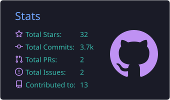
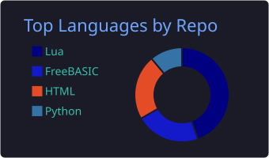

# Hi, I'm Manmadedrummer 👋

Indie dev: retro RPGs, arcade games, and WoW server scripting (Lua/AzerothCore). Heavy into prompt programming.

### 🎮 Featured project
**Araxia: Shadow of Etheros**, a full retro RPG in under 1.44 MB. Advanced past Round 1 of the 2p Arcade Games Floppy Drive Game Contest.

### 📊 Languages

